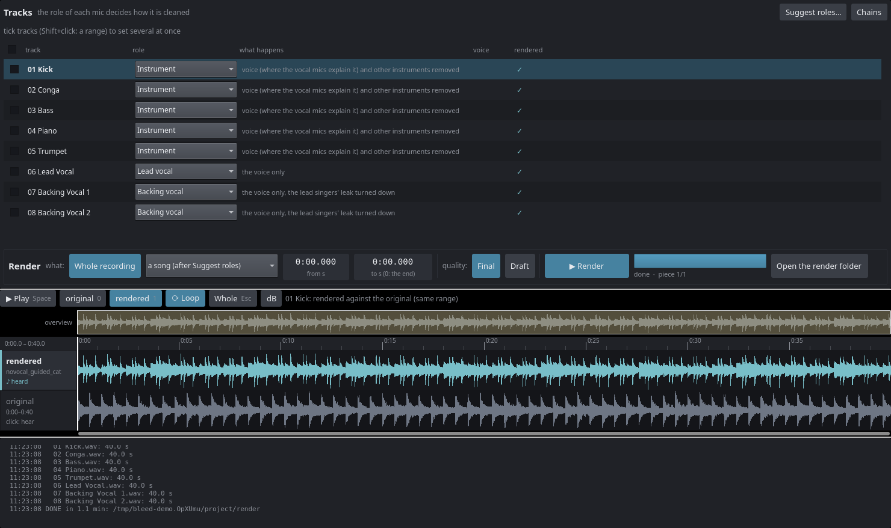

# MimoMusic Bleed Reduction

Cleans every microphone of a live multitrack recording: on each mic it keeps
the source the mic is meant for and takes out what leaked in from the rest of
the stage. The singers' voices come out of the instrument mics, the band comes
out of the vocal mics, and on the backing vocal mics the lead singer is turned
down. Made for concert recordings with many mics (bands with percussion, horns
and several singers), developed and tested with recordings from
[Ardour](https://ardour.org).

The result is one cleaned file per track, sample-aligned with the originals, so
it goes back into the session next to the original tracks.



*A made-up demo recording (`tools/make_demo.py`): the kick mic after cleaning
(top) against the original (bottom).*

## How it works, in short

Each track gets a **role**, and the role decides the chain:

| Role | For | What happens |
|---|---|---|
| Lead vocal | the lead singers' mics | the voice only (a vocal separation network) |
| Backing vocal | the coro mics | the voice only, and the lead singers' leak turned down |
| Instrument | every instrument mic (also horns, room mics) | the voices removed where the vocal mics explain them, then the other instruments by an instrument separation network: the mic's own category stays |
| Don't clean | DI and line signals, anything to keep as it is | a copy of the original |

**Suggest roles…** proposes them from the recording. The networks are
pretrained models by their authors (Mel-Band RoFormer for the voice, HTDemucs
for the instruments); `install.sh` downloads them. Details:
[docs/HOW_IT_WORKS.md](docs/HOW_IT_WORKS.md).

## Requirements

- Linux, Debian or Ubuntu (`install.sh` uses apt); Qt 6.5 or newer, Python 3
- about 2 GB of disk for the Python environment and the network weights
- an NVIDIA graphics card is strongly recommended. AMD chips and cards work
  through ROCm when the check at install finds them right and faster than the
  processor. On the processor alone it works but is slow: try single songs in
  Draft quality.
- Ardour 9 (`ardour9-lua`) to import an Ardour session directly; any folder of
  WAV files works too

## Install

```sh
git clone https://github.com/mimo-music/mimomusic-bleed-reduction.git
cd mimomusic-bleed-reduction
./install.sh          # system packages (asks for the password once), Python environment, network weights, the app
```

`./install.sh --check` shows what is there and what is missing, `./install.sh
--help` the options (`--cpu`, `--cuda`, `--rocm`, …). `./uninstall.sh` removes
what it added. The app is built outside the checkout, in `../builds/`.

## Quick start

```sh
bleed-reduction       # the app (also in the menu)
```

1. **New project…** → a folder of WAV stems (one file per mic), or an Ardour
   session (closed in Ardour; the session folder is only read).
2. Set the **role** of each track, or let **Suggest roles…** propose them.
3. In the **Render** box choose what (whole recording, a song, from–to) and the
   quality, then **▶ Render**.
4. The cleaned files are in `<project>/render/<track>.wav`.

To try it without a recording of your own: `python3 tools/make_demo.py
/tmp/demo` writes a made-up eight-track band, then **New project…** → that
folder. The full guide: [docs/USER_GUIDE.md](docs/USER_GUIDE.md).

## Documentation

| | |
|---|---|
| [User guide](docs/USER_GUIDE.md) | install, projects, roles, rendering, getting the result into Ardour |
| [How it works](docs/HOW_IT_WORKS.md) | the cleaning per role, the networks, segments, quality, speed |
| [Models and licenses](docs/THIRD_PARTY.md) | the networks and libraries used, their licenses and training data |

## Folders

- `app/` — the Qt 6 / QML program (`Product.qml`, `src/Studio.*`).
- `tools/` — the processing, in Python: `project.py` (projects: import,
  suggest roles), `render.py` (the render), `steps/` (the processing steps),
  `scan.py` and `timeline.py` (delays, leak, songs), `device.py` (where the
  networks run), `export_raw_stems.sh` (tracks out of an Ardour session),
  `make_demo.py` (the made-up demo recording).
- `tests/` — the tests below.

## Tests

```sh
bash tests/demo_test.sh                  # demo recording, project, Draft render, the app's self-test
bash tests/demo_test.sh --no-render      # the same without the networks
bash tests/ardour_export_raw_test.sh     # Ardour session export (needs ardour9-lua)
```

## License

GNU General Public License, version 3 or later (GPL-3.0-or-later), see
[LICENSE](LICENSE). Copyright (C) 2026 Mettronic GmbH. MimoMusic is a
brand of Mettronic GmbH. Other licensing terms (for example for
commercial or embedded use) are available from Mettronic GmbH.

The network weights are not part of this repository: `install.sh` downloads
them from their authors, under their own terms (see
[docs/THIRD_PARTY.md](docs/THIRD_PARTY.md)).

## Contributing

Contributions are welcome. Please read [CONTRIBUTING.md](CONTRIBUTING.md)
and the [Contributor License Agreement](CLA.md) before opening a pull
request.
